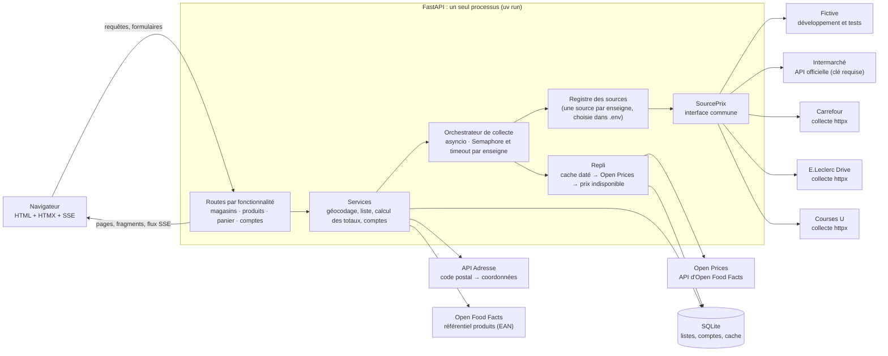
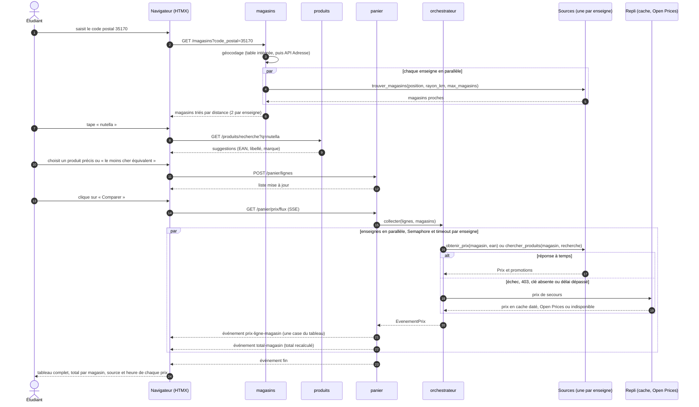
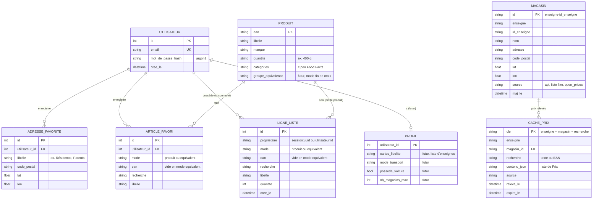

# Architecture

> Document de référence sur la structure du projet. **À mettre à jour dès que la structure change**
> (nouveau module, nouveau schéma, nouvelle route, nouvelle table). Les décisions et leurs raisons sont dans
> [`decisions.md`](decisions.md), les lots et leur statut dans [`taches.md`](taches.md).

## 1. Objectif

Un site qui aide un étudiant à payer ses courses moins cher. L'utilisateur saisit son code postal. Le site trouve
les magasins proches des quatre enseignes (Carrefour, Intermarché, Courses U, E.Leclerc Drive). L'utilisateur compose
ensuite sa liste de courses, et le site affiche le prix de chaque article dans chaque magasin et le total du panier
par magasin, promotions comprises. Chaque prix indique sa source et l'heure du relevé. Tout est utilisable sans
compte. Avec un compte, on peut en plus enregistrer des articles et des adresses favoris.

Contrainte principale : une démo qui marche le **samedi 28 novembre 2026 à 13h**.

## 2. Choix d'architecture

**Retenu : un seul serveur FastAPI (option A).** Les pages sont rendues en Jinja2 et mises à jour avec HTMX. Les prix
arrivent au fil de l'eau par Server-Sent Events (SSE), avec le support SSE intégré à FastAPI (`fastapi.sse`) et
l'extension SSE de HTMX. Une API JSON (`/api/...`) expose les mêmes schémas Pydantic,
pour les tests et pour d'éventuels autres clients. On lance un seul processus avec `uv run`.

Options écartées :

| Option | Pourquoi elle est écartée |
|---|---|
| B. FastAPI en API JSON + interface JavaScript (React ou Alpine) | Deuxième langage et chaîne npm, types en double (Pydantic et TypeScript), deux processus : 2 à 3 h de plus sur 20 h |
| C. Streamlit ou NiceGUI | Le script relancé à chaque clic se combine mal avec asyncio et l'affichage progressif, comptes et tests pytest maladroits |

## 3. Vue d'ensemble



## 4. Organisation du code (par fonctionnalité)

Le code est rangé par fonctionnalité pour que quatre personnes et leurs agents travaillent en même temps sans toucher
aux mêmes fichiers. L'arborescence exacte et les commandes sont dans [`AGENTS.md`](../AGENTS.md).

| Dossier / fichier | Rôle | Statut |
|---|---|---|
| `app/main.py` | Crée l'application et inclut **tous** les routers dès le départ | partagé, ne bouge plus |
| `app/config.py` | Réglages lus dans `.env` (pydantic-settings), tous pré-déclarés | partagé, ajout concerté |
| `app/db.py` | Connexion `sqlite3`, exécute au démarrage les schémas déclarés par chaque fonctionnalité | partagé |
| `app/contrats.py` | Schémas Pydantic communs (le contrat) | partagé, **modification concertée** |
| `app/gabarits.py` | Moteur Jinja2 commun, filtres `euros` et `releve`, `rendre()` pour les fragments SSE | partagé, ajout concerté |
| `app/sources/` | `base.py` (interface `SourcePrix`), `registre.py`, puis un fichier par source : `fictive.py`, `intermarche.py`, `carrefour.py`, `leclerc.py`, `coursesu.py`, `open_prices.py` | un fichier = un lot ou sous-lot |
| `app/collecte/` | `orchestrateur.py` (parallélisme, limites), `repli.py`, `cache.py`, `prechauffer.py` (commande) | lot données et fiabilité |
| `app/magasins/` | Ville, code postal ou position GPS → magasins proches (OpenStreetMap, `data/magasins/osm.json`) triés par distance, dans un rayon choisi ou les plus proches | lot Intermarché et magasins |
| `app/produits/` | Recherche d'un article pour composer la liste (Open Food Facts) | lot données et fiabilité |
| `app/panier/` | Liste de courses, flux SSE des prix, `calcul.py` (totaux, fonctions pures) | lot interface + cœur |
| `app/comptes/` | Inscription, connexion, articles et adresses favoris | lot Intermarché et magasins |
| `app/templates/` | `base.html`, `erreur.html` + un sous-dossier par fonctionnalité (`magasins/`, `produits/`, `panier/`, `comptes/`) | lot interface |
| `app/<fonctionnalite>/schema.sql` | Tables SQLite de la fonctionnalité, créées au démarrage | la fonctionnalité concernée |
| `tests/` | Un fichier de test par fonctionnalité, jamais de réseau | chacun pour son lot |

Règle : un lot ne modifie que ses fichiers. Les fichiers marqués « partagé » ne reçoivent que des **ajouts**, annoncés
dans `decisions.md` et commités à part.

## 5. Contrat : schémas Pydantic (`app/contrats.py`)

Le contrat est fixé dès le squelette pour que l'interface, le serveur et les sources avancent en parallèle.

```text
Enseigne      = carrefour | intermarche | coursesu | leclerc
TypeSource    = api | collecte | open_prices | cache | fictive
ModeLigne     = produit (EAN exact) | equivalent (moins cher qui correspond à la recherche)
StatutPrix    = trouve | introuvable | indisponible | en_attente
TypePromo     = immediate | lot | fidelite

Position      { lat, lon }
Magasin       { id "<enseigne>-<id_enseigne>", enseigne, id_enseigne, nom, adresse, code_postal, ville,
                position, distance_km? }
Produit       { ean?, libelle, marque?, quantite? ("1 L", "400 g") }
Promotion     { libelle, type, remise_centimes, quantite_min = 1, fin? }
Prix          { magasin_id, produit, prix_centimes, prix_barre_centimes?, prix_unitaire_centimes?, unite?,
                promotions[], source, source_detail, releve_le, est_fictif }
LigneListe    { id, mode, ean?, recherche, libelle, quantite = 1 }
ResultatLigne { ligne_id, magasin_id, statut, prix?, sous_total_centimes? }
TotalMagasin  { magasin, total_centimes, economies_centimes, nb_trouves, nb_manquants, complet }
EvenementPrix { resultat: ResultatLigne }

MagasinsReponse { code_postal, position, magasins[] }
AjoutLigne      { mode, ean?, recherche, libelle?, quantite = 1 }
TotauxReponse   { lignes[], magasins[], resultats[], totaux[] }
```

Conventions du contrat :

- Tous les montants sont en **centimes entiers**.
- `Prix.prix_centimes` est le prix payé en caisse pour une unité, sans condition. Une promotion immédiate y est déjà
  déduite, et `prix_barre_centimes` garde l'ancien prix pour l'affichage.
- `releve_le` est en UTC et s'affiche à l'heure de Paris.
- `est_fictif = True` pour toute donnée fictive, toujours affichée comme telle.

## 6. Interface commune des sources (`app/sources/base.py`)

Toutes les sources de prix ont les mêmes méthodes. Le reste de l'application ne dépend que de cette interface.

```python
class SourcePrix(ABC):
    enseigne: Enseigne
    type_source: TypeSource

    async def trouver_magasins(
        self, position: Position, rayon_km: float, max_magasins: int
    ) -> list[Magasin]: ...
    async def chercher_produits(
        self, magasin: Magasin, recherche: str, limite: int = 20
    ) -> list[Prix]: ...
    async def obtenir_prix(
        self, magasin: Magasin, ean: str
    ) -> Prix | None: ...  # prix + promotions
```

- Une source lève `SourceIndisponible` en cas d'échec (403, délai, format inattendu) et `SourceNonConfiguree` quand
  il lui manque un réglage (par exemple, pas de clé Intermarché). Elle n'affiche jamais rien elle-même.
- `registre.py` choisit pour chaque enseigne la source décrite dans `.env` (`SOURCE_CARREFOUR=fictive|collecte`, etc.).
  Par défaut, toutes les enseignes utilisent la source fictive, si bien que chaque lot peut activer sa vraie source
  pendant que les autres restent fictives.

## 7. Collecte : parallélisme, limites, cache et repli

L'orchestrateur (`app/collecte/orchestrateur.py`) reçoit les lignes de la liste et les magasins choisis. Il lance
« lignes × magasins » tâches et rend chaque résultat dès qu'il arrive.

- **En parallèle** : toutes les enseignes en même temps (asyncio + httpx).
- **Limite de requêtes simultanées** : un `asyncio.Semaphore` par enseigne (`CONCURRENCE_PAR_ENSEIGNE=3`).
- **Limite de temps** : `asyncio.timeout` par enseigne (`TIMEOUT_ENSEIGNE_S=6`). Une enseigne lente ou en échec
  n'empêche pas d'afficher les autres.
- **Magasins interrogés** : par défaut les 2 plus proches par enseigne (`MAX_MAGASINS_PAR_ENSEIGNE=2`) dans un rayon
  réglable (`RAYON_KM=10`).
- **Mode produit** : `obtenir_prix(magasin, ean)`. **Mode équivalent** : `chercher_produits(magasin, recherche)`,
  puis on garde le moins cher (au prix unitaire si toutes les offres l'ont, sinon au prix).
- **Cache** (`app/collecte/cache.py`) : chaque résultat est stocké dans SQLite. La clé est enseigne + magasin +
  recherche, et la durée de validité se règle avec `CACHE_TTL_MIN`. Un résultat encore valide évite la requête.
- **Repli** (`app/collecte/repli.py`), dans cet ordre : dernier prix en cache, même périmé, avec sa date, puis
  Open Prices, puis « prix indisponible ». L'utilisateur ne voit jamais d'erreur brute.
- **Préchauffage** : `app/collecte/prechauffer.py` remplit le cache à l'avance à partir de `data/demo/recherches.txt`,
  pour préparer la démo (prix réels dans `cache_prix`, réponses Open Prices et Open Food Facts dans `cache_reponse`).
- **Open Prices** (`app/sources/open_prices.py`) : le magasin correspond au lieu OpenStreetMap de même enseigne le
  plus proche, à moins de 2 km (enseigne lue dans `osm_brand`, sinon dans `osm_name`). On garde le relevé le plus
  récent de chaque EAN, de moins de 2 ans. Réponses gardées 24 h en cache, et réutilisées même anciennes si le
  service ne répond plus ou si `OPEN_PRICES_ACTIF=false`.
- **Référentiel produits** (`app/produits/service.py`) : recherche sur `search.openfoodfacts.org` (la recherche
  classique renvoie 503), reclassée sur place (tous les mots, EAN français d'abord, popularité), un appel par seconde
  au plus, réponses gardées 7 jours, catalogue fictif en secours. Produits enregistrés dans la table `produit`.
- **Respect des sites** : requêtes modérées, en-têtes de navigateur normaux, JSON chargé par le site plutôt que
  HTML, Playwright seulement si indispensable. **On ne contourne jamais une protection anti-robots.**

État des sources au 27/11/2026 (détails en annexe) :

| Source | État | Conséquence |
|---|---|---|
| Intermarché (API officielle) | **Pas de clé** : demande pas encore approuvée. Produits v1 marquée « Deprecated » | Sans `INTERMARCHE_API_KEY`, **aucune requête** : repli direct. Magasins depuis une liste fixe (Rennes, Bruz) ou Open Prices |
| Carrefour (collecte) | curl → 403 Cloudflare `cf-mitigated: challenge`. Le JSON `routeData` se lit bien dans une page normale | Collecte à écrire plus tard (Codex). Si 403 : repli |
| Courses U (collecte) | curl → 403 Cloudflare | Idem |
| E.Leclerc Drive (collecte) | curl → 403 DataDome | Idem |
| Open Prices | Répond, mais données éparses et anciennes : autour de Rennes, presque aucun relevé de moins de 2 ans (Intermarché Super : 2 sur 787, E.Leclerc Cleunay : 57, surtout des biscuits) | Source de secours, peu de trous comblés. Relevés de moins de 2 ans, date complète affichée |
| Fictive | Toujours disponible | Développement, tests, démo de secours, toujours marquée |

## 8. Parcours principal



Routes prévues :

| Méthode et chemin | Rôle | Réponse |
|---|---|---|
| `GET /` | Accueil : ville, code postal ou « Me localiser », et rayon | page |
| `GET /magasins?code_postal=` | Magasins proches | page |
| `GET /api/magasins?code_postal=` | Magasins proches | `MagasinsReponse` |
| `GET /produits/recherche?q=` | Suggestions d'articles | fragment |
| `GET /api/produits?q=` | Suggestions d'articles | `list[Produit]` |
| `GET /panier` | Liste de courses et tableau des prix | page |
| `POST /panier/lignes`, `DELETE /panier/lignes/{id}` | Modifier la liste de la session | fragment |
| `GET /panier/prix/flux` | Prix et totaux au fil de l'eau | flux SSE (fragments HTML) |
| `POST /api/panier/totaux` | Calcul complet sans session (code postal + lignes) | `TotauxReponse` |
| `/comptes/...` | Inscription, connexion, favoris | pages (lot comptes) |

Événements SSE : `prix-<ligne_id>-<magasin_id>` (case du tableau), `total-<magasin_id>` (total du magasin),
`resume` (classement final) et `fin`. À la réception de `fin`, HTMX ferme la connexion (`sse-close="fin"`), ce qui
évite que le navigateur relance toute la collecte en se reconnectant.

## 9. Calcul du total (`app/panier/calcul.py`)

Fonctions pures, sans réseau, testées à part.

- Sous-total d'une ligne = `quantite × prix_centimes − remises`.
- Promotion `immediate` : déjà déduite de `prix_centimes`. Elle sert seulement à afficher l'économie.
- Promotion `lot` (ex. « le 2e à -50 % ») : `remise_centimes` est appliquée une fois par groupe de `quantite_min`
  articles.
- Promotion `fidelite` : enregistrée mais **non déduite** tant que l'utilisateur n'a pas déclaré la carte
  (fonctionnalité « long terme »).
- Total du magasin = somme des sous-totaux des lignes trouvées. `nb_manquants` compte les lignes introuvables ou
  indisponibles, et `complet = (nb_manquants == 0)`.
- Classement : d'abord les paniers complets du moins cher au plus cher, puis les incomplets par nombre de manquants.

## 10. Modèle de données (SQLite)

Chaque fonctionnalité déclare ses tables (`CREATE TABLE IF NOT EXISTS`) dans son propre fichier
`app/<fonctionnalite>/schema.sql`. Au démarrage, `app/db.py` exécute tous ces fichiers : ajouter une table ne demande
jamais de modifier un fichier partagé. Pas d'ORM, module `sqlite3` de Python. Au squelette : `panier/schema.sql`
(`ligne_liste`), `comptes/schema.sql` (`utilisateur`, `adresse_favorite`, `article_favori`) et `collecte/schema.sql`
(`cache_prix`, et `cache_reponse` pour les réponses brutes d'Open Prices et d'Open Food Facts). `produits/schema.sql`
déclare `produit` (lot 4). `MAGASIN` et `PROFIL` viendront avec leurs lots.



## 11. Sessions et comptes

- Un cookie signé (`SessionMiddleware`, clé `SECRET_KEY`) porte les clés `sid` (identifiant de session anonyme),
  `code_postal` (choisi sur la page des magasins) et, si l'utilisateur est connecté, `utilisateur_id` (posée par le
  module comptes).
- **Sans compte**, la liste est liée à la session (`proprietaire = "session:<uuid>"`). **Avec un compte**, elle est
  liée à l'utilisateur, et ses articles et adresses favoris sont enregistrés.
- Les mots de passe sont hachés en argon2 avec `pwdlib`. Pas de connexion par un service tiers.

## 12. Fonctionnalités secondaires : points d'accroche

Elles ne sont pas dans le squelette, mais le modèle les permet sans tout refaire.

| Fonctionnalité | Ce qui existe déjà | Ce qu'il faudra ajouter |
|---|---|---|
| Mode « fin de mois » | Lignes `equivalent`, `chercher_produits`, `PRODUIT.groupe_equivalence` | Règles d'équivalence (catégorie Open Food Facts + quantité), suggestions moins chères |
| Long terme (fidélité, avantages étudiants) | Promotions `fidelite` déjà stockées, table `PROFIL` prévue | Déclaration des cartes, prise en compte dans `calcul.py` |
| Trajet | Position de l'utilisateur et des magasins, `distance_km` | Module `trajets/` (mode de transport, temps de trajet), colonne dans le tableau |
| Nombre de magasins | Grille complète lignes × magasins (`ResultatLigne`) | Fonction de répartition sur N magasins qui minimise le total, dans `calcul.py` ou un module dédié |

## 13. Configuration (`.env`)

Tous les réglages sont pré-déclarés dans `app/config.py`, avec des valeurs par défaut qui marchent sans `.env`.
Modèle dans `.env.example`.

| Variable | Défaut | Rôle |
|---|---|---|
| `SOURCE_CARREFOUR`, `SOURCE_INTERMARCHE`, `SOURCE_COURSESU`, `SOURCE_LECLERC` | `fictive` | Source utilisée pour chaque enseigne |
| `RAYON_KM` | `10` | Rayon de recherche des magasins |
| `MAX_MAGASINS_PAR_ENSEIGNE` | `2` | Magasins interrogés par enseigne |
| `TIMEOUT_ENSEIGNE_S` | `6` | Limite de temps par enseigne |
| `TIMEOUT_REQUETE_S` | `5` | Limite de temps d'une requête (géocodage, Open Prices…) |
| `CONCURRENCE_PAR_ENSEIGNE` | `3` | Requêtes simultanées par enseigne |
| `CACHE_TTL_MIN` | `360` | Durée de validité du cache |
| `DELAI_FICTIF_MAX_S` | `0.8` | Délai aléatoire de la source fictive, pour voir les prix arriver un par un (0 dans les tests) |
| `INTERMARCHE_API_KEY` | vide | Clé de l'API Intermarché. Vide = aucune requête |
| `SECRET_KEY` | valeur de développement | Signature du cookie de session |
| `DB_PATH` | `data/app.db` | Fichier SQLite (ignoré par Git) |
| `SOURCE_PRODUITS` | `open_food_facts` | Référentiel produits : `open_food_facts` ou `fictive` (sans réseau) |
| `OPEN_PRICES_ACTIF` | `true` | Open Prices en secours. `false` = aucune requête (réponses déjà enregistrées seulement) |
| `OPEN_FOOD_FACTS_RECHERCHE_URL` | `https://search.openfoodfacts.org` | Service de recherche texte d'Open Food Facts |

## 14. Limites connues du squelette

- La page des résultats et le flux SSE appellent chacun `magasins_proches`. Avec la source fictive, les magasins sont
  identiques. Avec de vraies sources, il faudra mettre la liste des magasins en cache (table `MAGASIN`, lot 2 ou 4)
  pour que le tableau et le flux voient exactement les mêmes magasins.
- Les comptes et les sources réelles (Intermarché, collecte) sont des modules vides documentés (« BOUCHON » en tête
  de fichier). Le cache, Open Prices, la recherche Open Food Facts et le préchauffage sont faits (lot 4, 27/11).
- Le repli après un délai dépassé traite les lignes restantes en parallèle (lot 4).
- Le Dockerfile n'a pas pu être testé sur la machine du squelette (pas d'accès au démon Docker).

## Annexe : notes techniques sur les sources (relevées le 27/11/2026)

**Intermarché**, portail `developers.intermarche.com` (spécifications OpenAPI téléchargeables, bouton
« download spec »).

- *API Stores v1* : `GET https://api-partners.intermarche.com/v1/stores`, paramètres `lat`, `lon`, `r`, `postalCode`,
  `min`, `type`, `concept`, `service`, ou une zone `nw_lat`/`nw_lon`/`se_lat`/`se_lon`. En-tête `X-Api-Key`.
  Limites : 1 000 requêtes/h par application, 30 requêtes/s partagées. Pré-production :
  `ppr-api-partners.intermarche.com`.
- *Produits v1* (**Deprecated**) : base `https://api-partners.intermarche.com/produits/v1`. Routes
  `GET /pdvs/zone`, `GET /pdvs/{pdvId}/categories`, `POST /pdvs/{pdvId}/produits/search` (mot-clé, page, taille, tri)
  et `GET /pdvs/{pdvId}/produits/{productId}`. En-tête `apikey`. Champs utiles : `produitEan13`, `libelle`, `marque`,
  `prix`, `prixBarre`, `prixKg`, `remise`, `dateDebut`, `dateFin`, `stock`. Pas de recherche directe par EAN : on
  cherche par mot-clé, puis on filtre sur l'EAN.
- Contact indiqué dans la spécification Produits : ld_red_services@mousquetaires.com.

**Carrefour** (test du 27/11, Drive 136 « Rennes Centre Alma », recherche « lait »).

- `https://www.carrefour.fr/set-store/136` sélectionne le Drive, puis `https://www.carrefour.fr/s?q=lait` lance la
  recherche. Avec curl, la sélection renvoie 403 (`cf-mitigated: challenge`). Dans un navigateur normal, la page
  s'affiche sans défi.
- La page contient une propriété `"routeData"`. Sa valeur est une chaîne JSON qui encode un tableau aplati :
  l'élément 0 est la racine `{data, links, meta, global}`, et dans les objets et tableaux, chaque nombre est l'indice
  d'un autre élément (-1 = absent). On résout les indices récursivement.
- `data[i].attributes` contient `ean`, `title` et `brand`. Le prix est dans
  `attributes.offers[ean]["0039-150-136"].attributes.price.price`, avec aussi `perUnit` et `unitOfMeasure`. La présence
  de la clé `0039-150-136` confirme que le prix est celui du Drive demandé.
- Les promotions sont dans `.promotions[]` : `label`, `type`, `isLoyalty` (fidélité), `messageArgs.discountAmount` et
  `messageArgs.discountedPrice`. Exemples : « -15% Mardi PASS » et « -10% Club » (fidélité), « Le 2ème à -50% » (lot).
- Exemple : EAN 3276554163158, Lait demi-écrémé Carrefour Classic', 1,05 € (1,05 €/L).

**Open Prices** : `https://prices.openfoodfacts.org/api/v1/` (`prices`, `locations`). Les magasins sont des lieux
OpenStreetMap avec `osm_brand`. Couverture autour de Rennes au 27/11 : Carrefour Market 62 prix, E.Leclerc Cleunay
57, U Express 10, Intermarché Super 787, aucun lieu à Bruz.
